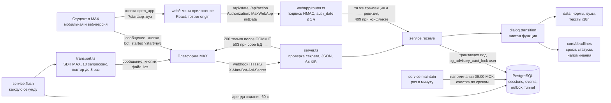

# Архитектура

Состояние на 25.09.2026, ветка `main`. Здесь описан работающий код. Исходный дизайн от
15.09 (Fastify, отдельный HTTP API) не реализован; мини-приложение сделано иначе — как
второй интерфейс к той же сессии (`D-028`). Его можно
посмотреть в истории git, `git show cf6c32e:docs/architecture.md`. Почему выбрали
иначе, записано в `docs/decisions.md`: D-009, D-012 и D-022.

## Коротко

Один процесс Node.js 24 на TypeScript: чат-бот MAX на официальном SDK
`@maxhub/max-bot-api`, база PostgreSQL 16 и Docker Compose. Основной интерфейс — чат:
сценарий состоит из последовательных вопросов, статусов и напоминаний (условия,
стр. 15). Мини-приложение показывает тот же план целиком и работает с той же сессией:
тот же процесс, тот же HTTPS-origin, тот же `transition()` (`D-028`, облик — `D-029`). Всё, что меняется при переносе в другой вуз, период или язык,
лежит в файлах `src/data/`, а не в коде.

## Модули

| Каталог | Что делает | Зависит от |
|---|---|---|
| `src/core/` | Даты без часовых поясов, расчёт сроков, статусы (`ok`, `dueSoon`, `overdue`, `done`), даты напоминаний, `coverage()`: какие периоды въезда и гражданства покрывают нормы | ничего, чистые функции |
| `src/data/` | Загрузка и проверка данных: нормы `rules/*.json`, профили вузов `universities/*.json`, тексты `i18n/<язык>.json`. Сверяет переводы и гражданства при запуске | `core` |
| `src/bot/dialog.ts` | Диалог как чистая функция `transition(сессия, ввод, контекст) → (сессия, ответ)`: экраны, кнопки с ревизией, язык, вуз из диплинка | `core`, `data` |
| `src/bot/service.ts` | Разбор событий MAX, идемпотентность, транзакция, постановка ответа и напоминаний в очередь, отправка с арендой | `dialog`, `db` |
| `src/bot/server.ts` | HTTP: `GET /health`, `POST /webhook`; коды 400, 401, 413, 415, 503 | `service` |
| `src/bot/transport.ts` | Отправка через SDK MAX: текст, callback, link и clipboard кнопки, загрузка `.ics` через `/uploads`; в демо без токена — консоль с пометкой `[MOCKED]` | SDK |
| `src/bot/calendar.ts`, `funnel.ts`, `commands.ts` | Файл календаря RFC 5545; обезличенные счётчики воронки; подсказки команд | `core`, `data` |
| `src/webapp/` | Мини-приложение на сервере: проверка подписи стартовых данных MAX (`initData.ts`), состояние экрана из сессии и действия через тот же `transition()` (`state.ts`), JSON API `/api/state`, `/api/action`, билет на `.ics` (`router.ts`), типы провода (`contract.ts`) | `dialog`, `db` |
| `web/` | Бандл мини-приложения: React, свой lock-файл; экраны по шагу сессии, MAX Bridge с веб-запасным путём, шрифты и фото вузов в бандле | `src/webapp/contract.ts` (только типы) |
| `src/db/` | Схема и миграции PostgreSQL, хранилище, одноразовый импорт из прежней SQLite | `pg` |
| `src/main.ts` | Запуск: конфиг из окружения, проверка данных, сервер, цикл очереди и обслуживания, остановка по сигналу | всё выше |
| `src/demo.ts`, `report.ts`, `qr.ts`, `subscribe.ts`, `commands.ts` | Инструменты оператора: сценарий демо, отчёт воронки, QR-плакат вуза, подписка webhook, подсказки команд | — |

## Поток одного действия

1. MAX присылает событие на `POST /webhook`. Сервер сверяет секрет за постоянное время,
   тип содержимого и размер тела.
2. `parseUpdate` превращает событие в ввод. Сообщения из групп отбрасываются. Из
   `bot_started` берутся `payload` (вуз из диплинка) и `user_locale` (язык).
3. В одной транзакции под блокировкой пользователя: отпечаток события (повтор
   игнорируется), `transition`, сохранение сессии, ответ в очередь `outbox`,
   пересчёт напоминаний, счётчики воронки.
4. Webhook отвечает 200 только после COMMIT. Если база недоступна — 503, и MAX
   повторит доставку.
5. Цикл очереди берёт задание с арендой и отправляет его. При сетевой ошибке
   повторяет с растущей задержкой, после 8 попыток помечает `failed`; счётчик
   виден в `/health`. Напоминание перед отправкой пересчитывается: отмеченная или
   просроченная процедура отменяет его, кроме одного напоминания на следующий день
   после срока.

## Что где меняется при переносе

| Изменение | Где | Правка кода |
|---|---|---|
| Новый вуз | `src/data/universities/<id>.json` + плакат `npm run qr <id>` и блок для письма о зачислении `npm run invite <id>` | нет, тест `tests/university.test.ts` |
| Новый язык | `src/data/i18n/<код>.json` + переводы названий в нормах и вузах | нет, тест `tests/i18n.test.ts` |
| Новый период въезда, исключённое гражданство | условия `appliesIf` в `src/data/rules/*.json` | нет, тест `tests/segment.test.ts` |
| Новая процедура со сроком от даты въезда | правило в `src/data/rules/*.json` | нет, движок общий |
| Новое базовое событие (не въезд) | `core/types.ts` и вопрос в диалоге | да |

Подробно — `docs/product/scaling.md`.

## Надёжность и данные

- Один процесс на одну базу. Несколько реплик не поддерживаются. Блокировка по
  пользователю и аренда заданий защищают от гонок внутри процесса и при перезапуске.
- Доставка не «ровно один раз»: при обрыве связи после отправки возможен дубль.
- В базе хранятся MAX ID, язык, даты и отметки. Паспорта, сканы и тексты сообщений
  не хранятся. `/delete` удаляет профиль и задания. Воронка — суммы по дням без ID.
  Сроки хранения описаны в README.
- Нормы пока в статусе `draft`, поэтому режим `APP_MODE=live` бот не запускает.

## Внешние зависимости

| Что | Зачем | Без неё |
|---|---|---|
| Платформа MAX (`platform-api2.max.ru`) | Приём и отправка сообщений | Демо в консоли, `[MOCKED]` |
| PostgreSQL 16 | Состояние и очередь | Тесты и демо поднимают временную базу сами (`embedded-postgres`) |
| HTTPS на 443 (Caddy на ВМ) | Требование MAX к webhook и мини-приложению | Локально не нужен |

Библиотеки для работы бота — SDK MAX и `pg`. TypeScript, Vitest, `embedded-postgres`
и `qrcode-generator` нужны только для разработки.
