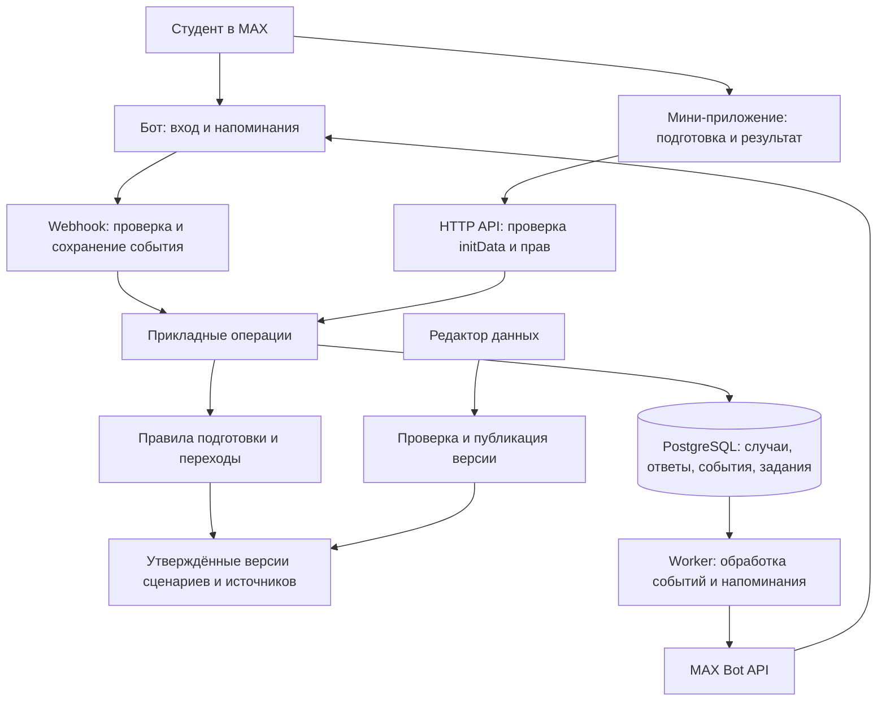

# Предлагаемая архитектура

Статус: **дизайн для обсуждения**, 15.09.2026. Стек не принят окончательно, реализации
и тестов продукта нет. Основание: [проблема](product/problem.md), [сценарий](product/mvp.md).

## Выбор

Модульный монолит на TypeScript: один backend и один процесс фоновых задач из общей
кодовой базы; React + MAX UI для мини-приложения; PostgreSQL для состояния и очереди;
HTTPS reverse proxy; Docker Compose для воспроизводимости. Предлагаемые инструменты:
Node.js, Fastify, React/Vite, SQL-миграции, Vitest и Playwright. Версии и совместимость
фиксируем после проверки реестров при реализации, здесь номера не угадываем.

Цель разделения — изменения интерфейса не затрагивают правила подготовки, а сбой
отправки сообщения не уничтожает сохранённые ответы. Микросервисы, Kafka, Kubernetes
и универсальный workflow-конструктор не требуются выбранными нагрузкой и сценарием.

Редактор — первоначально участник команды, проверяющий файлы через Git. Отдельный
кабинет публикации создаём только при появлении владельца процесса, которому он нужен.

## Модули и контракты

| Модуль | Ответственность | Что возвращает |
|---|---|---|
| `identity` | Проверить подписанные данные MAX, выдать ограниченную сессию, проверить владельца случая | Локальный пользователь и права |
| `cases` | Создать случай, сохранить ответы, применить действие с проверкой версии | Новая версия случая |
| `preparation` | Определить применимость и недостающие пункты | Статус подготовки, следующий шаг, ссылки на основания |
| `content` | Загрузить только опубликованные версии, проверить применимость и срок пересмотра | Версия сценария и источники |
| `notifications` | Согласие, время, отмена, попытки доставки | Задание и наблюдаемый результат отправки |
| `max` | Проверить webhook, преобразовать события, вызвать документированный API | Типизированное внутреннее событие |
| `analytics` | События прохождения без содержимого документов | Агрегированные показатели |

Планируемые операции HTTP API: создание/чтение собственного случая, изменение ответов,
завершение подготовки, создание/отмена напоминания, удаление собственных данных.
Для мутаций — идентификатор операции и ожидаемая версия случая. При конфликте вернуть
понятное обновление состояния; повтор кнопки не создаёт второй случай или напоминание.
Это собственный API, поэтому в сдаче нужны OpenAPI 3.x, DATA-API.yaml, тестовые роли
и данные; «внутренний backend» не используем как повод пропустить требования ТЗ.

## Модель данных

- `User`: внутренний ID, MAX ID, язык, параметры согласия. Телефон не нужен по умолчанию.
- `Case`: владелец, организация, `scenario_version`, версия записи, состояние подготовки.
- `Answer`: код вопроса, значение, отметка происхождения «пользователь».
- `ScenarioVersion`: поддерживаемые условия, шаги, зависимости, ссылки на основания.
- `SourceVersion`: URL, территория, категория, период действия, дата проверки,
  дата следующего пересмотра, ответственный. Контрольная сумма фиксирует версию,
  но сама по себе не доказывает актуальность.
- `CaseEvent`: действие, исполнитель, время, версия до/после; без секретов.
- `Reminder` / `Outbox`: когда отправить, какой шаг, попытки, статус и версия случая.

Состояния подготовки: `draft → preparing → ready`; отдельно `needs_clarification`
и `archived`. Возвращённый ответ может снова перевести `ready` в `preparing`.
Официальное состояние заявления не хранится в том же поле. Будущее подтверждение
сотрудника — отдельная сущность с происхождением и полномочиями.

## Основной поток и надёжность

1. Mini app отправляет серверу `initData`; сервер проверяет подпись и давность по
   [официальной инструкции MAX](https://dev.max.ru/docs/webapps/validation).
   Доверять присланному `user_id` или `initDataUnsafe` нельзя.
2. Сервер создаёт случай на опубликованной версии сценария. Запрос каждого случая
   проверяет владельца; ID в URL/диплинке не даёт доступа.
3. Изменение ответов, пересчёт и запись событий/заданий выполняются транзакционно.
   Правила не зависят от сетевого ответа в момент пользовательского клика.
4. Входящий webhook проверяется, устойчиво записывается, затем подтверждается.
   При отказе БД успешное подтверждение не отправляется. Секрет, HTTPS и ограничения
   сверяются с [POST /subscriptions](https://dev.max.ru/docs-api/methods/POST/subscriptions).
5. Worker забирает задания с блокировкой и сроком владения, повторяет временные
   ошибки с задержкой, учитывает лимиты MAX, выводит исчерпанные попытки в диагностику.
6. Перед отправкой сверяет согласие и текущий шаг: завершённому шагу не напоминаем.
   Успех API означает принятие сообщения, а не доказанное прочтение человеком.

Побочные эффекты устойчивы к повтору входящего события. При неопределённом исходе
исходящего запроса возможен дубль сообщения: не обещаем exactly-once доставку без
гарантий MAX. Кнопка такого сообщения остаётся безопасной и идемпотентной.

## Обновление официальных данных

Источник → обнаружение изменения → проверка человеком → контрольные случаи →
публикация версии → список затронутых случаев → явное обновление рекомендаций.

Не перезаписывать активные маршруты незаметно. Храним их версию, но отозванное или
утратившее применимость правило не продолжаем показывать как актуальное: предупреждаем,
блокируем уверенный вывод и предлагаем пересмотр/официальный контакт. Напоминания,
основанные на изменённых правилах, пересчитываем или отменяем.

На первом шаге проверяем наличие, а не подлинность документов. Автоматический расчёт
юридических сроков появляется только после утверждения нормативной формулы, календаря,
часового пояса и контрольных примеров; до этого возможны пользовательские напоминания.

## MAX и демонстрация платформы

Основной кандидат на бонус: сохранённая подготовка → напоминание ботом → открытие
нужного шага через диплинк → завершение. Это должно давать измеримое возвращение к
задаче; бонус решает жюри, обычное уведомление само по себе его не гарантирует.

Диплинк содержит непрозрачный идентификатор, не паспортные данные и не токен доступа.
Опциональный QR выбирает контекст вуза, если он реально нужен каналу распространения;
ручной выбор остаётся доступен. Не добавляем биометрию ради демонстрации возможностей.
Совместимость и fallback проверяем по [Bridge](https://dev.max.ru/docs/webapps/bridge):
состояние хранится на сервере, основной сценарий не зависит от мобильного хранилища.

## Границы ИИ

В основном сценарии генеративная модель не нужна: применимость, комплектность и
состояния определяются проверяемыми правилами. Возможное распознавание документов
или упрощение языка — отдельная гипотеза после исследования. Она должна улучшить
метрику относительно формы/проверенного перевода и не определять нормативный вывод.
Модель, API и лицензия не выбраны; закрытый/частный API нельзя молча включить вопреки
п. 7 ТЗ. До такого добавления проверяем допустимость и воспроизводимость.

## Развёртывание, безопасность и проверки

- Сервер приложения, worker, PostgreSQL и reverse proxy в Compose; один публичный
  HTTPS-домен. Резервные копии БД с проверкой восстановления.
- Один активный потребитель токена. Мониторинг живости, готовности БД, возраста
  очереди, ошибок MAX и состояния webhook; тестовое оповещение при аварии.
- Сессии ограничены по времени; права проверяются сервером, данные разных
  пользователей изолированы. Админ/будущий сотрудник имеет отдельные права и аудит.
- Секреты только в окружении; подписанные данные авторизации и содержимое документов
  не попадают в логи. Состав, основание и сроки обработки согласуются до пилота.
- Правила проверяем эталонными случаями, включая неподдерживаемые условия, отсутствующие
  ответы и смену версии. Интеграционно: дубли событий, рестарт worker, отказ БД/MAX,
  чужой case ID, отмена напоминания. UI: сохранение/возврат/ошибка в Playwright.
- Ручной полный прогон в мобильном и веб-MAX обязателен: браузерный тест его не заменяет.
- Чистая Docker-сборка ≤ 5 минут без загрузки базовых образов; зависимости закреплены,
  тяжёлые модели и браузеры не скачиваются в runtime-образ для основного сценария.
